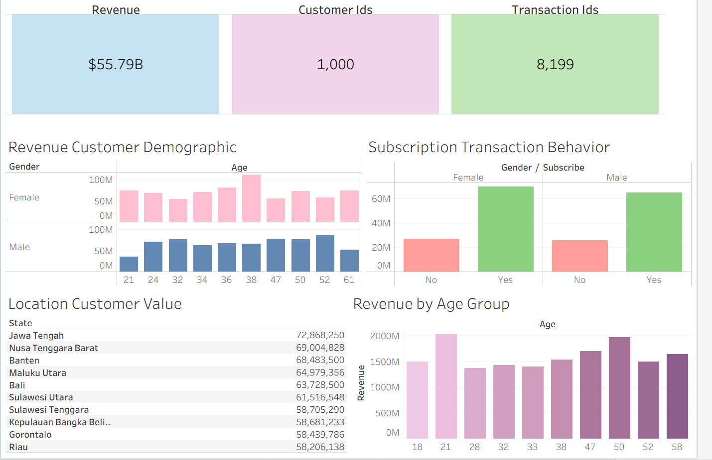

# ecommerce-sales-analysis
Analyzing customer spending patterns across 8,199 e-commerce transactions and 1,000 customers to investigate how subscription status, demographics, and geographic location relate to revenue and purchasing behavior.

### Table of Contents

- [Project Overview](#project-overview)
- [Data Sources](#data-sources)
- [Recommendations](#recommendations)
- [Dashboard](#dashboard)

## Repository

```text
ecommerce-eda/
│
├── README.md
│
├── notebooks/
│   ├── transactions_cleaned.ipynb
│   ├── customer_cleaned.ipynb
│   └── merged_data.ipynb
│
├── data/
│   ├── transactions_cleaned.csv
│   ├── customers_cleaned.csv
│   └── merged_dataset.csv
│
└── dashboard/
    └── ecommerce_dashboard.png
```


### Project Overview

This project aims to uncover patterns and relationships between customer characteristics and transaction behavior. Using an e-commerce dataset, the analysis explores revenue, customer activity, and purchasing behavior across different customer segments and geographic locations. The goal is to identify meaningful patterns in customer behavior and provide data-driven insights into e-commerce performance.

### Data Sources

E-commerce Dataset Kaggle: Contains customer, order, product, seller, payment, review, and geolocation data used for the analysis.

The public datasets "transactions.csv" and "customers.csv" were combined and cleaned using Python (Pandas) before analysis and visualization in Tableau.

Link to public dataset: https://www.kaggle.com/datasets/saidnizam/messy-e-commerce-dataset

### Tools

Python: Used for data cleaning, data transformation, exploratory data analysis and preparing the datasets for visualization.

Pandas: Used within Python to clean, manipulate, combine, and analyze the customer and transaction datasets.

Matplotlib: Used to create visualizations for exploratory data analysis, including distributions, relationships and outlier analysis.

Tableau: Used to create visualizations and the final dashboard, including KPIs, revenue analysis, customer analysis, and transaction behavior.

Excel: Used for inspecting and working with the dataset during the data preparation process.

### Data Cleaning/Preparation

1. Loaded and inspected the customer and transaction datasets to understand their structure, data types, missing values, and potential data quality issues.
2. Cleaned and transformed the data in Python using Pandas, including handling missing values, checking data types, and creating calculated fields such as revenue.
3. Merged the customer and transaction datasets using customer_id to connect customer characteristics with transaction data.
4. Created additional features such as revenue per transaction and age groups to support customer and revenue analysis.
5. Prepared the cleaned dataset for exploratory data analysis and visualization in Tableau.

### Exploratory Data Analysis

To answer game retention questions such as:

- Which customer segments generated the most revenue
- Which states have the most revenue per customer
- Are there unusual or extreme revenue values in the dataset?

### Results/Findings
- Subscriptions increased generated more revenue than non-subscribers, suggesting a relationship between subscription status and customer spending
- Female customers (both subscribed and non-subscribed) generated more revenue than subscribed and non-subscribed male customers
- The revenue distribution contained significant outliers and highly-skewed data that requires further investigation

### Recommendations
- Investigate revenue outliers to determine whether it's legitimate high-value purchases or data quality issues
- Look into subscription behavior since subscribers generated more revenue, further analyze subscription plans, purchase frequency and customer lifetime value
- Analyze customer transaction frequency in the states to consider tailoring marketing and promotions

### Limitations

- There was some missing customer data of approximately 5.6% of customers had missing age data and 5.3% were missing state data in the records
- The merged dataset structure would contain customers with multiple transactions and had to use "COUNTD(Customer ID)" to properly analyze the distinct customers
- The dataset mainly focuses on customer and transaction variables and does not account for other factors such as product preferences and customer lifetime value

### Dashboard


